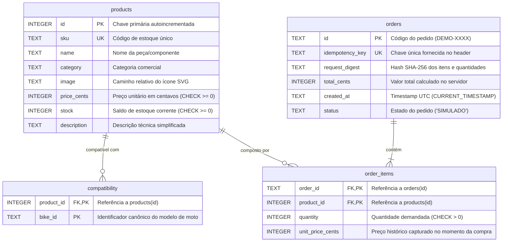
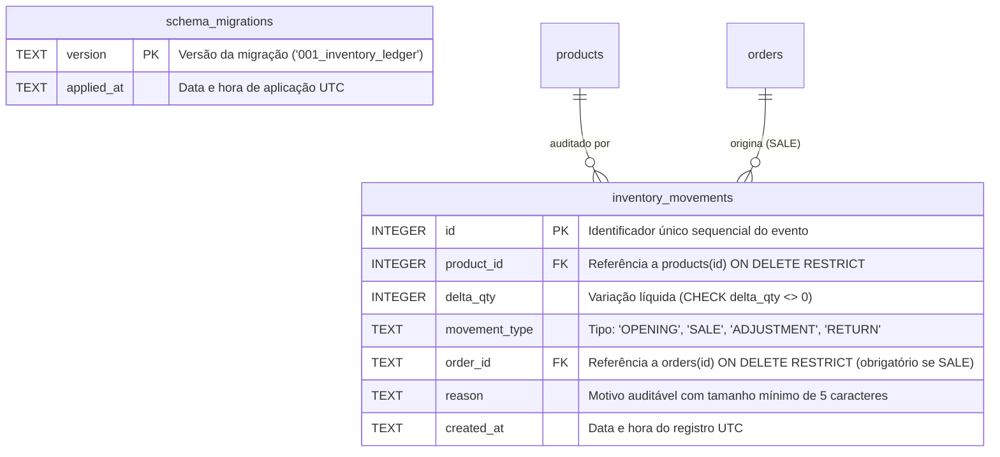

# Relatório Técnico Completo — Exercício 2: Evolução do Banco de Dados
**Engenharia de Software Avançada com IA · Curso de Sistemas de Informação**  
**Projeto:** Loja Didática Rota 2 Motopeças — Extensão Didática de Persistência (Opção A · REV05)  
**Docente:** Prof. Fernando Garcia | **Semestre:** 2026.2

---

## 1. Atividade 1 — Documentação do Esquema Legado e Auditoria

### 1.1 Diagrama Entidade-Relacionamento (DER) Legado
O banco de dados original em SQLite (`data/motopecas.db`, implementado em `app/db.py`) é composto por quatro tabelas relacionais em terceira forma normal operacional:



### 1.2 Dicionário de Dados do Esquema Legado
| Tabela | Coluna | Tipo | Restrições | Descrição Semântica |
|---|---|---|---|---|
| **products** | `id` | INTEGER | PRIMARY KEY | Identificador numérico interno |
| | `sku` | TEXT | NOT NULL, UNIQUE | Código SKU padronizado (ex.: `R2-FR-001`) |
| | `name` | TEXT | NOT NULL | Nome comercial sintético do item |
| | `category` | TEXT | NOT NULL | Categoria comercial (Freios, Motor, etc.) |
| | `image` | TEXT | NOT NULL | Caminho estático de asset visual local |
| | `price_cents`| INTEGER | NOT NULL, CHECK(price_cents >= 0) | Preço em centavos para evitar ponto flutuante |
| | `stock` | INTEGER | NOT NULL, CHECK(stock >= 0) | Saldo acumulado atual disponível |
| | `description`| TEXT | NOT NULL | Resumo de aplicação e características |
| **compatibility** | `product_id` | INTEGER | NOT NULL, REFERENCES products(id) | Chave estrangeira para produto |
| | `bike_id` | TEXT | NOT NULL | Identificador do modelo de motocicleta |
| | *PK* | PRIMARY KEY | (product_id, bike_id) | Chave composta de compatibilidade |
| **orders** | `id` | TEXT | PRIMARY KEY | Identificador alfanumérico simulado |
| | `idempotency_key` | TEXT | NOT NULL, UNIQUE | Chave de idempotência (HTTP Header) |
| | `request_digest` | TEXT | NOT NULL | Digest SHA-256 do payload do pedido |
| | `total_cents` | INTEGER | NOT NULL | Total consolidado em centavos |
| | `created_at` | TEXT | NOT NULL, DEFAULT CURRENT_TIMESTAMP | Registro temporal em formato ISO |
| | `status` | TEXT | NOT NULL, DEFAULT 'SIMULADO' | Status da simulação de checkout |
| **order_items** | `order_id` | TEXT | NOT NULL, REFERENCES orders(id) | Chave estrangeira do pedido |
| | `product_id` | INTEGER | NOT NULL, REFERENCES products(id) | Chave estrangeira do produto |
| | `quantity` | INTEGER | NOT NULL, CHECK(quantity > 0) | Quantidade adquirida no pedido |
| | `unit_price_cents` | INTEGER | NOT NULL | Preço unitário histórico no momento da compra |
| | *PK* | PRIMARY KEY | (order_id, product_id) | Chave primária composta da linha |

### 1.3 Fluxos da API e da CLI Administrativa
1. **Fluxo de Consulta (`GET /api/products`):** Filtra por termo (`q`), categoria (`category`), compatibilidade (`bike`) e ano (`year`). As compatibilidades são resolvidas via subselect `EXISTS` em `compatibility`.
2. **Fluxo de Checkout (`POST /api/orders`):**
   - Valida idempotência via `Idempotency-Key` e `request_digest`.
   - Abre transação explícita com `BEGIN IMMEDIATE` para obter trava de escrita (write lock) no SQLite.
   - Verifica saldo e calcula total no servidor (o cliente nunca define o preço).
   - Insere `orders`, `order_items` e executa `UPDATE products SET stock = stock - ?`.
   - Executa `COMMIT` ou `ROLLBACK` completo em caso de exceção.
3. **Fluxo da CLI Administrativa (`app.manage`):**
   - Permite listar pedidos (`orders`) ou alterar estoque diretamente (`stock <sku> <qty>`).

### 1.4 Matriz de Fatos Observados vs. Hipóteses
| Elemento | Classificação | Justificativa Técnica / Evidência no Código |
|---|---|---|
| Uso de SQLite com 4 tabelas | **FATO OBSERVADO** | Declarado no DDL de `app/db.py` linhas 34-65. |
| SQL parametrizado sem SQLi | **FATO OBSERVADO** | Comprovado em `app/main.py` e testado em `tests/test_api.py`. |
| Ausência de PII e pagamentos | **FATO OBSERVADO** | Modelos Pydantic contêm apenas `product_id` e `quantity`. |
| Ausência de histórico de estoque | **FATO OBSERVADO** | No legado, `products.stock` é um campo sobrescrito por `UPDATE`, sem trilha de auditoria. |
| DDL embutido no startup da API | **FATO OBSERVADO** | `app/db.py:initialize()` chamado no lifespan do FastAPI. |
| Necessidade imediata de PostgreSQL | **HIPÓTESE REJEITADA** | Com 12 produtos e tráfego didático, SQLite atende com folga. Não há evidência de saturação. |
| Reconstrução histórica de vendas passadas | **HIPÓTESE REJEITADA** | Impossível sem log anterior de eventos; saldos legados devem ser fixados em marco T0 (`OPENING`). |

---

## 2. Atividade 2 — Extensão Aditiva de Persistência (Livro-Razão)

### 2.1 Modelo Aditivo com Livro-Razão (Ledger)
Para suprir a lacuna de auditoria sem quebrar contratos legados, foram introduzidas duas novas entidades:
1. `schema_migrations`: Registra as versões aplicadas de migrações estruturais.
2. `inventory_movements`: Livro-razão (ledger imutável append-only) que rastreia todo débito, crédito ou ajuste de estoque.



### 2.2 Dicionário de Dados das Novas Tabelas e Índices
| Tabela / Índice | Definição | Restrições / Regras |
|---|---|---|
| `schema_migrations.version` | TEXT | PRIMARY KEY. Garante execução única de cada migração. |
| `schema_migrations.applied_at` | TEXT | NOT NULL, DEFAULT CURRENT_TIMESTAMP. |
| `inventory_movements.id` | INTEGER | PRIMARY KEY. Autoincrementado. |
| `inventory_movements.product_id` | INTEGER | NOT NULL, REFERENCES products(id) ON DELETE RESTRICT. |
| `inventory_movements.delta_qty` | INTEGER | NOT NULL, CHECK(delta_qty <> 0). Movimentos nulos são proibidos. |
| `inventory_movements.movement_type` | TEXT | CHECK(movement_type IN ('OPENING','SALE','ADJUSTMENT','RETURN')). |
| `inventory_movements.order_id` | TEXT | REFERENCES orders(id) ON DELETE RESTRICT. Obrigatório para vendas. |
| `inventory_movements.reason` | TEXT | NOT NULL, CHECK(length(trim(reason)) >= 5). Motivo explicativo. |
| `inventory_movements.created_at` | TEXT | NOT NULL, DEFAULT CURRENT_TIMESTAMP. |
| `ux_opening_product` | UNIQUE INDEX | `WHERE movement_type = 'OPENING'`. Proíbe duplicidade de saldo inicial por produto. |
| `ux_sale_order_product` | UNIQUE INDEX | `WHERE movement_type = 'SALE'`. Proíbe duplicidade de venda para o mesmo item/ordem. |
| `ix_compat_bike` | INDEX | Otimização para filtros por modelo de motocicleta. |
| `ix_products_category` | INDEX | Otimização para filtros por categoria. |
| `ix_movements_product` | INDEX | Otimização para cálculo e reconciliação de saldo por produto. |

### 2.3 Invariantes de Negócio em Linguagem Natural
- **INV-DB-01 (Conservação e Reconciliação):** Para todo produto cadastrado, o saldo em `products.stock` deve ser estritamente igual à soma algébrica de `delta_qty` em `inventory_movements` desde o marco T0:
  $$\text{products.stock} = \sum_{\text{movements desde T0}} \text{delta\_qty}$$
- **INV-DB-02 (Estoque Não Negativo):** Nenhuma transação pode resultar em saldo inferior a zero (`CHECK stock >= 0`).
- **INV-DB-03 (Idempotência Estrita):** O reenvio de um pedido com a mesma `Idempotency-Key` e idêntico payload deve retornar o pedido anterior sem debitar estoque adicional e sem gerar novos registros no ledger.
- **INV-DB-04 (Integridade Referencial e Validação):** Nenhuma chave estrangeira pode ficar órfã (`PRAGMA foreign_keys = ON`, `ON DELETE RESTRICT`) e todas as restrições `CHECK` devem ser respeitadas.
- **INV-DB-05 (Isolamento de Ambientes e Governança):** Nenhuma alteração estrutural ou script de laboratório pode rodar diretamente na base operacional `data/motopecas.db` sem isolamento em prefixo `lab_*`, backup consistente e aprovação humana explícita.

### 2.4 Marco Inicial T0 (Saldo de Abertura)
A inserção dos movimentos com `movement_type = 'OPENING'` na primeira migração representa uma **fotografia do saldo existente no instante T0 da migração**. A engenharia REA rejeita a alegação de reconstrução histórica retrospectiva de pedidos anteriores, pois tal dado não constava nos registros auditados.

---

## 3. Atividade 3 — Migração 001 Idempotente e Isolamento

### 3.1 Script DDL (`sql/schema_proposto_001.sql`)
O script SQL define a extensão de forma estritamente aditiva:
- Não descarta (`DROP`) nenhuma tabela existente;
- Cria `schema_migrations` e `inventory_movements`;
- Cria os índices únicos condicionais e índices de performance;
- Define as regras de integridade `CHECK` e `ON DELETE RESTRICT`.

### 3.2 Script Utilitário Seguro (`scripts/lab_db_extension.py`)
Implementa comandos CLI de laboratório com salvaguardas rigorosas:
- **Barreira de Segurança (`safe_path`):** Rejeita sumariamente qualquer operação que tente manipular arquivos que não comecem pelo prefixo `lab_` ou que não possuam extensão de banco de dados (`.db`, `.sqlite`, `.sqlite3`), impedindo acidentes na base de desenvolvimento `data/motopecas.db`.
- **Backup Online (`backup`):** Utiliza a API `sqlite3.Connection.backup()` para obter cópia transacionalmente consistente da base mesmo durante operações, calculando digest SHA-256 e salvando metadados em JSON.
- **Restauração em Banco Separado (`restore`):** Restaura para um novo arquivo (`_restored.db`) e valida `PRAGMA integrity_check` e `PRAGMA foreign_key_check` antes de declarar sucesso.
- **Migração Idempotente (`migrate`):** Executa dentro de `BEGIN IMMEDIATE`. Se `001_inventory_ledger` já constar em `schema_migrations`, efetua `COMMIT` imediato e encerra sem efetuar mudanças redundantes.

---

## 4. Atividade 4 — Comprovação Experimental do Caso RED e Caso GREEN

### 4.1 Ensaio RED (Detecção Deliberada de Divergência)
No banco de laboratório `data/lab_deliberate_red.db`, simulou-se uma alteração de estoque não instrumentada (comportamento do código legado sem ledger):
```python
# UPDATE direto em products.stock sem gravar evento em inventory_movements
db.execute("UPDATE products SET stock = stock - 3 WHERE sku = 'R2-FR-001'")
```
Ao executar a verificação de integridade (`lab_db_extension.verify`):
```text
SQLite: 3.45.1 integrity: ok FK violations: 0 ledger discrepancies: 1
{'sku': 'R2-FR-001', 'stock': 17, 'balance': 20}
VERIFY FALHOU COM EXIT CODE 2 (COMPORTAMENTO ESPERADO NO CASO RED)
```
**Resultado do Teste RED:** Divergência acusada com precisão matemática: saldo na tabela de produtos é 17, mas o livro-razão aponta 20. O comando encerrou com código de saída 2, provando que o mecanismo de conciliação detecta desvios.

### 4.2 Ensaio GREEN (Instrumentação Transacional Atômica)
No banco `data/lab_deliberate_green.db`, executou-se a alteração com a transação devidamente instrumentada (padrão adotado na API e CLI):
```python
db.execute("BEGIN IMMEDIATE")
row = db.execute("SELECT id, stock FROM products WHERE sku = 'R2-FR-001'").fetchone()
db.execute("UPDATE products SET stock = stock - 3 WHERE id = ?", (row["id"],))
append_inventory_movement(db, product_id=row["id"], delta_qty=-3, 
                          movement_type="ADJUSTMENT", reason="ajuste instrumentado para caso GREEN")
db.execute("COMMIT")
```
Ao executar a verificação de integridade (`lab_db_extension.verify`):
```text
SQLite: 3.45.1 integrity: ok FK violations: 0 ledger discrepancies: 0
PASS: conciliação e integridade.
CASO GREEN PASSOU COM 0 DISCREPANCIAS!
```
**Resultado do Teste GREEN:** Reconciliação sem discrepâncias e integridade confirmada com status PASS.

---

## 5. Atividade 5 — Provas de Integridade e Contratos de Robustez

A suíte `tests/test_db_rev05.py` implementa 13 testes de contrato executados com sucesso:
1. **Atomicidade e Rollback:** Testado em `test_failed_ledger_insert_rolls_back_order_and_stock`. Quando uma trigger ou falha aborta a inserção do movimento no ledger, toda a transação sofre rollback (`ROLLBACK` do SQLite), garantindo que nem o saldo de estoque nem o pedido ou itens de pedido permaneçam gravados parcialmente.
2. **Estoque Não Negativo:** Testado em `test_insufficient_stock_has_no_side_effects`. Pedidos solicitando quantidade superior ao estoque disponível retornam HTTP 409 e não geram registros órfãos.
3. **Idempotência sem Duplo Débito:** Testado em `test_idempotency_replay_does_not_duplicate_sale`. O reenvio de pedido com a mesma `Idempotency-Key` e payload idêntico retorna o pedido anterior com `replayed: True` e não insere nova linha em `inventory_movements`.
4. **Concorrência e Prevenção de Overselling:** Testado em `test_concurrent_orders_never_oversell`. Duas requisições paralelas concorrendo pela última unidade restante (estoque = 1) são serializadas pela transação `BEGIN IMMEDIATE`. Exatamente uma obtém sucesso (201 Created) e a outra recebe 409 Conflict. O saldo final é 0, com exatamente um movimento `SALE` registrado.
5. **Auditoria Administrativa Local:** Testado em `test_cli_stock_adjustment_and_reason`. Alterações pela ferramenta administrativa exigem motivo explícito (`--reason`, mínimo 5 caracteres) e gravam movimento `ADJUSTMENT`. Deltas nulos são ignorados sem gerar ruído.

---

## 6. Atividade 6 — Backup, Restauração e Análise de SGBD (ADR)

### 6.1 Execução de Backup e Restauração em Ambiente Isolado
Logs reais obtidos na execução do laboratório:
1. **Inicialização do baseline:**
   ```text
   .venv/bin/python scripts/lab_db_extension.py init --db data/lab_rota2.db
   Base pronta: 12 produtos
   ```
2. **Backup online consistente:**
   ```text
   .venv/bin/python scripts/lab_db_extension.py backup --db data/lab_rota2.db
   Backup completo: .../data/lab_rota2_backup.db
   sha256: 9172b46dbb749584d5c32766b0563785412b90e651d588afce73476372cf8434
   ```
3. **Restauração e validação automática:**
   ```text
   .venv/bin/python scripts/lab_db_extension.py restore --db data/lab_rota2.db
   RESTORE PASS: .../data/lab_rota2_restored.db produtos: 12 FK violadas: 0
   ```
4. **Aplicação e verificação da migração:**
   ```text
   .venv/bin/python scripts/lab_db_extension.py migrate --db data/lab_rota2.db
   Migração aplicada.
   .venv/bin/python scripts/lab_db_extension.py verify --db data/lab_rota2.db
   SQLite: 3.45.1 integrity: ok FK violations: 0 ledger discrepancies: 0
   PASS: conciliação e integridade.
   ```

### 6.2 Análise Decisória de SGBD (SQLite vs. PostgreSQL) e WAL
- **Por que Manter SQLite no Protótipo Didático:**
  - Zero dependência externa de infraestrutura, portas de rede ou credenciais de banco.
  - Performance para leituras concorrentes extremamente rápida em memória/disco local.
  - Conformidade total com ACID local através de `BEGIN IMMEDIATE`.
  - Custo operacional e de hospedagem zero.
- **Ressalvas Críticas sobre o Modo WAL (Write-Ahead Logging):**
  - O SQLite é mono-escritor (single-writer) mesmo no modo WAL; ele permite leitores concorrentes ao único escritor, mas **não permite múltiplos escritores simultâneos**.
  - O SQLite documentou um bug raro de WAL-reset corrigido na versão 3.51.3 e em alguns backports. Por segurança e estabilidade didática, o modo WAL **não foi habilitado automaticamente**.
- **Critérios Objetivos e Mensuráveis para Futura Migração ao PostgreSQL:**
  1. *Concorrência de Escrita:* Taxa sustentada de escrita superior a 100 requisições/segundo onde o tempo de espera por lock (`SQLITE_BUSY`) exceda 5% das transações.
  2. *Escalabilidade Horizontal:* Necessidade de distribuir a API FastAPI em múltiplos servidores/containers stateless acessando um pool centralizado de dados.
  3. *Controle de Acesso em Nível de Linha (RLS):* Exigência de políticas de segurança multi-tenant ou usuários com privilégios diferenciados no próprio SGBD.
  4. *Volume de Dados:* Catálogo superando dezenas de milhares de SKUs com necessidade de particionamento e réplicas de leitura assíncronas.

---

## 7. Atividade 7 — Governança e Gates Técnicos de Aceitação

| Gate | Critério Objetivo | Evidência Comprovada | Veredito |
|---|---|---|---|
| **G-DB1** | Conciliação sem divergências em todos os 12 produtos após migração e operações. | Saída real de `lab_db_extension.py verify` com `ledger discrepancies: 0`. | **PASS** |
| **G-DB2** | `PRAGMA foreign_key_check` sem registros e `integrity_check = ok`. | Validação executada pelo script de restore e no teste `test_online_backup_restore_integrity`. | **PASS** |
| **G-DB3** | Falha transacional não deixa atualização parcial; rollback comprovado. | Comprovado no teste `test_failed_ledger_insert_rolls_back_order_and_stock` (Trigger rollback). | **PASS** |
| **G-DB4** | Repetição de `idempotency_key` não gera segundo débito nem movimento duplicado. | Comprovado no teste `test_idempotency_replay_does_not_duplicate_sale`. | **PASS** |
| **G-DB5** | Tanto API quanto CLI registram eventos de estoque de forma transacional. | Comprovado em `test_sale_debits_and_records_in_same_transaction` e `test_cli_stock_adjustment_and_reason`. | **PASS** |

### 7.1 Parecer e Decisão Humana
Todas as etapas de modelagem, migração, testes e auditoria foram rigorosamente cumpridas no ambiente isolado. O código está versionado na branch de entrega `entrega/rea-motopecas`. Conforme a regra de governança REA (regra 7), a aplicação deste pacote no banco de dados operacional de produção permanece classificada como **`NEEDS_HUMAN`**, aguardando aprovação explícita do professor.
